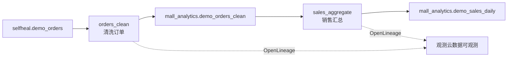

# 订单清洗与销售汇总：数据可观测演示

这个演示把商城实际订单转换为清洗表和每日销售表，通过 OpenLineage 把作业状态、输入输出、表结构与处理行数发送到观测云的「数据可观测」。独立的 Python CronJob 每五分钟执行一次，组件版本为 `0.1.1`。



## 观测对象和数据口径

| 对象 | 可以看到什么 |
| --- | --- |
| 两个作业 | 最近状态、每次运行、开始与结束时间、耗时、失败原因 |
| 三个数据集 | 稳定名称、Schema、输入与输出行数、由哪个作业读取或生成 |
| 数据血缘 | 订单源表 → 清洗 → 清洗表 → 汇总 → 每日销售表 |
| 故障影响 | 清洗失败后汇总终止；汇总失败时上一次汇总结果和处理时间保留 |

- 每次运行固定提取窗口：北京时间今天及之前六天，从首日零点到作业启动时刻，左闭右开。MySQL 会话使用 UTC，按北京时间生成 `order_date`。
- 清洗保留 `CONFIRMED` 且 SKU 去除两端空格后非空、数量和订单总金额都大于零的记录；源表只读。输入行数与输出行数之差就是窗口内被排除的行数。
- `amount_cent` 已经是订单总金额，销售额用 `SUM(amount_cent)`，不能再乘数量。组合购物车的 SKU 字符串不用于按 SKU 分摊收入。
- 每日输出包括订单数 `order_count`、件数 `units`、销售额（分）`revenue_cent`。输出表表示本轮整个窗口快照，不是长期历史仓库。
- 重跑相同窗口不会新增重复行。每个阶段在一个事务中替换输出；故障发生于 DELETE 后、COMMIT 前，用来验证回滚。
- OpenLineage 只上传元数据，不上传订单行、用户 ID、请求 ID 或口令。源数据集 Schema 描述本作业使用的列。

## 安装

在能访问目标集群的管理机上使用 Python 3、kubectl 和 Helm 3。默认命名空间是 `observability-demo`，现有 MySQL Service 为 `demo-observability-demo-mysql`，源表为 `selfheal.demo_orders`。

```bash
# 从已有 DataKit 的 ENV_DATAWAY 复制该空间的接入 Token，过程不输出口令。
python3 scripts/data-observability-bootstrap.py --from-datakit

# 安装独立 Release mall-data，默认暂停调度。
scripts/data-observability.sh install
scripts/data-observability.sh run normal
scripts/data-observability.sh status
scripts/data-observability.sh logs <上一步返回的Job名称>
```

初始化脚本创建 `mall_analytics` 数据库和 `mall_pipeline` 账号：源表仅有 SELECT 权限，分析库只有 SELECT/INSERT/UPDATE/DELETE/CREATE 权限。口令与接入 Token 存入已有名称可引用的 Secret `mall-data-pipeline`。MySQL Deployment 需要通过 `MYSQL_ROOT_PASSWORD` 提供管理员口令；脚本通过容器内部环境变量调用 MySQL，不把口令放进命令参数。

已有 DataKit 使用 Secret 引用、接入其他环境或无需复制 DataKit Token 时，提供本机受保护的 Token 文件：

```bash
export OPENLINEAGE_TOKEN_FILE=/secure/path/workspace-ingestion-token
python3 scripts/data-observability-bootstrap.py
```

跨集群部署可用 Helm `--set` 或私有 values 文件调整 `mysql.host`、`openlineage.url`、`openlineage.datasetNamespace` 和 Secret 引用。`openlineage.url` 仅允许 HTTPS origin，路径 `/v1/write/openlineage` 由发送器添加，使用 `X-Token` 请求头认证。2026-10-22 的 Demo 接收端对 Bearer 返回 `dataway.emptyToken`，使用 X-Token 已实际验证。自建数据库/账号时可直接创建同名 Secret，无需执行初始化脚本。

请在「观测云演示Demo → 数据可观测」选择最近 15 分钟或 1 小时，按 Job namespace `mall-demo.data-pipeline` 查看：

1. 作业列表出现 `orders_clean`、`sales_aggregate`，运行最终为 COMPLETE。
2. 数据目录出现源表、清洗表和销售汇总表，Schema 与处理行数可见。
3. 血缘能够连接两道作业和三张表。

确认这些结果后启用定时调度，并等待至少一次自动运行：

```bash
scripts/data-observability.sh enable
scripts/data-observability.sh status
```

## 五分钟演示脚本

为保持手工演示中的状态，先暂停自动调度。手动作业仍能运行；每次等前一 Job 结束再启动下一次，避免 MySQL 互斥锁返回 busy。

```bash
scripts/data-observability.sh suspend
scripts/data-observability.sh run normal
scripts/data-observability.sh run fail-clean
scripts/data-observability.sh run recovery
scripts/data-observability.sh run fail-aggregate
scripts/data-observability.sh run slow 30
scripts/data-observability.sh run recovery
scripts/data-observability.sh enable
```

| 模式 | orders_clean | sales_aggregate | 数据结果 |
| --- | --- | --- | --- |
| normal / recovery | COMPLETE | COMPLETE | 刷新两张输出表 |
| fail-clean | FAIL | START 后 ABORT | 两张输出表都保留上一次结果 |
| fail-aggregate | COMPLETE | FAIL | 清洗表更新，汇总表保留旧结果和处理时间 |
| slow 30 | COMPLETE | START 后等待约 30 秒再 COMPLETE | 用运行时长变化演示慢作业 |
| replay | 不执行新业务作业 | 不执行新业务作业 | 补发此前未投递的原事件 |

故障只存在于本次手动 Job 的参数，不会写入 CronJob 配置。受控失败使 Kubernetes Job 显示 Failed，这是演示预期。两个作业位于同一个 Kubernetes Job 中，它们在观测云里有独立 Run ID。

## 检查处理结果

使用具备只读权限的 SQL 客户端查询：

```sql
SELECT COUNT(*) AS clean_orders, SUM(quantity) AS units,
       SUM(amount_cent) AS revenue_cent FROM mall_analytics.demo_orders_clean;
SELECT order_date, order_count, units, revenue_cent, processed_at
FROM mall_analytics.demo_sales_daily ORDER BY order_date;
SELECT COUNT(*) AS pending_events FROM mall_analytics.openlineage_outbox
WHERE delivered_at IS NULL;
SELECT job, state, started_at, finished_at
FROM mall_analytics.pipeline_runs ORDER BY started_at DESC LIMIT 12;
```

`openlineage_outbox` 和 `pipeline_runs` 是内部投递与恢复表，不作为业务数据集上报。成功输出和终态事件在同一事务提交。已投递事件与已结束运行保留七天，待投递事件一直保留。突然终止导致的未结束运行，在下一次取得互斥锁时补充 ABORT。

## 投递与排障

- HTTP 429/5xx 和网络错误最多尝试三次，尊重有上限的 Retry-After 并使用退避；其他 4xx 或重定向不立即重试。失败后本次进程停止进一步投递，事件留在队列，下一次运行或 `replay` 重试原 JSON 和 Run ID。
- `dataway.cached` 表示接收端接受后等待投递，仍要检查控制台最终是否可查询。HTTP 成功不等于端到端验收通过。
- 业务成功但投递失败时，进程退出码为 3，已提交业务结果和 COMPLETE 事件保持原义；业务失败为 2，互斥锁忙为 4，配置/基础设施错误为 1，全部成功为 0。
- 队列按顺序投递，一条未通过的事件会阻塞后续事件。修复 Token/接入地址或事件兼容性后执行 `run replay`；不要删除待投递事件来掩盖故障。
- 查看 Job 日志中的 `stage_finished` 和 `lineage_delivery_pending`；运行日志不输出 HTTP 响应正文、数据库异常原文或认证信息。真实数据库异常保留类型名称，受控故障保留明确说明。

## 开发验证与版本

```bash
uv sync --project data-pipeline --frozen --python 3.12
uv run --project data-pipeline ruff check data-pipeline scripts/data-observability-bootstrap.py
uv run --project data-pipeline mypy data-pipeline/src
uv run --project data-pipeline pytest data-pipeline/tests -m 'not integration'
data-pipeline/tests/integration.sh
helm lint charts/data-observability-demo
bash -n scripts/data-observability.sh
```

集成测试会自动创建和删除自己的 MySQL 8.4 容器，并用本地 HTTP 接收器验证事件补发。官方 OpenLineage 2-0-2 JSON Schema 随测试保存，测试无需请求外部 Schema 服务。

构建上下文是 `data-pipeline/`，依赖由 `uv.lock` 固定。独立 Chart version/appVersion、Python 包版本和镜像 tag 同步；线上部署建议通过 `image.digest` 固定具体内容。新增组件不改变商城 Java/Web/RUM/SourceMap/Android 的版本。CI 工作流为 `.github/workflows/data-pipeline.yml`。

## 回滚

```bash
scripts/data-observability.sh suspend
# 确认运行中的 Job 已结束后：
scripts/data-observability.sh uninstall
```

回滚仅卸载独立的 `mall-data` Release，分析库、专用账号和凭据 Secret保留，以便检查和补发；商城源订单及原有 Release 不受影响。需要彻底清理时再单独审阅删除分析库、账号和 Secret 的范围。

线上版本、故障回滚、自动调度和控制台证据见 [2026-10-22 部署验收记录](deployments/data-observability-20261022.md)。

官方接口说明：[观测云 OpenLineage 集成](https://docs.guance.com/integrations/openlineage/)。

扩展演示见 [Java 经营日报、Spark 销售趋势与商城报表](report-jobs.md)，沿用本 pipeline 的输出和调度。
