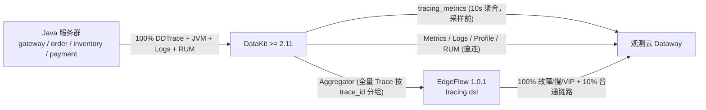

# EdgeFlow 链路尾采样（Tail Sampling）接入与对比演练

本文说明如何在不破坏默认部署的前提下，为 `observability-demo` 叠加 **EdgeFlow 1.0.1 单采样模式**（同时支持 Docker Compose 本地预览与 Kubernetes / EKS Workshop），并通过工作台右侧「故障注入控制台 → 基础设施 → EdgeFlow 尾采样对比压测」一键验证降噪、降本、末端故障 100% 保全与 APM 服务指标 100% 保真。

---

## 1. 数据流与规则口径



仓库规则文件位于 [`observability/edgeflow/rules/tracing.dsl`](../observability/edgeflow/rules/tracing.dsl)：

- **时间窗口**：`idle 5s max_wait 30s decision_ttl 2m`（链路静默 5 秒即完成决策投递，兼顾秒级排障体验与跨节点汇集）。
- **100% 优先保留**：
  - 下游任意一跳报错：`any(tag.status == "error")`（如第 4 跳 `payment_error`、第 3 跳 `inventory_redis_timeout`）；
  - 任意 Span 慢于 1 秒：`any(field.duration > 1000000)`（DataKit `ddtrace` 微秒单位）；
  - 显式服务端故障枚举：`any(tag.fault_id in ["order_slow", "redis_timeout", "payment_slow", "payment_error", "payment_cpu_burn"])`；
  - 登录 VIP 用户订单：`any(tag.user_tier == "vip")`。
- **100% 定向丢弃**：公网扫描器未注册路径与静态资源 `any(tag.route_class in ["unmatched", "static_asset"])` 及健康检查（不粗暴丢弃全部 `404`，保留小游戏 `game_asset_load_failure` 的有效 404 观测）。
- **常态兜底采样**：其余普通健康链路 `sample 0.1 otherwise seed "mall-demo-edgeflow-v1"`（仅保留约 10%）。

先在本地离线校验并回放测试样本（125 条演练链路 + 慢链路 / VIP / 游戏 404）：

```bash
scripts/edgeflow-rules.sh validate
scripts/edgeflow-rules.sh test
```

---

## 2. Docker Compose 本地叠加步骤

1. 确保本地容器版 DataKit 版本为 **2.11 及以上**，并连接到外部网络 `datakit-demo-net`。
2. 在 `.env` 中补充 EdgeFlow 凭据（不要提交真实凭据）：
   ```bash
   EDGEFLOW_ADMIN_TOKEN="$(openssl rand -hex 24)"
   EDGEFLOW_DEMO_TOKEN="<你的观测云工作空间 Dataway Token>"
   ```
   若对接非默认 `https://openway.guance.com` 站点，可复制 `observability/edgeflow/edgeflow.toml` 为本地文件并设置 `EDGEFLOW_CONFIG_PATH`。
3. 启动应用与 EdgeFlow（已内置 `platform: linux/amd64`，兼容 Apple Silicon）：
   ```bash
   docker compose -f compose.yaml -f compose.datakit.yaml -f compose.edgeflow.yaml up -d --build
   scripts/edgeflow-rules.sh apply-docker --if-match 0
   ```
4. 在本地 DataKit 中挂载 [`observability/edgeflow/datakit-aggr/aggr.toml`](../observability/edgeflow/datakit-aggr/aggr.toml) 与 [`tail-sampling.toml`](../observability/edgeflow/datakit-aggr/tail-sampling.toml)，设置 `ENV_AGGREGATOR_ENDPOINTS=http://observability-demo-edgeflow:9529?token=<WORKSPACE_TOKEN>`、`ENV_AGGREGATOR_USE_LOCAL_CONFIG=true`，并参考 [`observability/datakit-values-edgeflow.example.yaml`](../observability/datakit-values-edgeflow.example.yaml) 开启 `tracing_metric_interval = "10s"` 及内部控制接口 `close_resource` 后重启 DataKit。

---

## 3. Kubernetes / EKS Workshop 可选叠加步骤

1. 在 `datakit` 命名空间创建运行凭据与连接地址 Secret（切勿写入仓库）：
   ```bash
   kubectl create namespace datakit --dry-run=client -o yaml | kubectl apply -f -

   kubectl -n datakit create secret generic edgeflow-credentials \
     --from-literal=EDGEFLOW_ADMIN_TOKEN="$(openssl rand -hex 24)" \
     --from-literal=EDGEFLOW_DEMO_TOKEN="$WORKSPACE_TOKEN" \
     --dry-run=client -o yaml | kubectl apply -f -

   kubectl -n datakit create secret generic datakit-edgeflow-endpoints \
     --from-literal=endpoints="http://edgeflow-0.edgeflow.datakit.svc.cluster.local:9529?token=${WORKSPACE_TOKEN}" \
     --dry-run=client -o yaml | kubectl apply -f -
   ```
2. 部署 EdgeFlow StatefulSet 并首次应用本地 DSL 规则：
   ```bash
   kubectl apply -f observability/edgeflow/k8s-edgeflow.example.yaml
   kubectl -n datakit rollout status statefulset/edgeflow --timeout=3m
   scripts/edgeflow-rules.sh apply-k8s --if-match 0
   ```
3. 使用官方 DataKit Chart **2.19.2**（满足 `>= 2.11` 要求）与单采样叠加配置安装或升级 DataKit：
   ```bash
   helm upgrade --install datakit datakit/datakit \
     --version 2.19.2 \
     --namespace datakit \
     --create-namespace \
     -f observability/datakit-values-edgeflow.example.yaml \
     --set-string datakit.dataway_url="$DATAWAY_URL" \
     --set-string datakit.cluster_name_k8s="$EKS_CLUSTER_NAME"
   ```

后续若只调整采样率或保留策略，修改 `tracing.dsl` 后执行 `scripts/edgeflow-rules.sh apply-docker` 或 `apply-k8s` 即可热生效，**无需重启 DataKit 或任何业务微服务**。

---

## 4. 一键对比压测与观测深链验收

1. 打开工作台 `business.html?scene=bookstore&view=web`，在右侧 **故障注入控制台 → 基础设施** 下选择 **EdgeFlow 尾采样对比压测**。
2. 点击 **运行尾采样压测（125 请求）**（或通过命令行执行 `curl -fsS -X POST "${DEMO_BASE_URL:-http://127.0.0.1:8080}/api/demo/edgeflow/drill"`）。
3. 后端会以独立根 `trace_id` 经由 `gateway-service` 依次发出：
   - **20 次**未注册扫描探测（`404`，`route_class=unmatched`）；
   - **100 次**健康下单（`GET /api/orders/demo`）；
   - **5 次**第 4 跳 `payment_error` 故障下单（结束后自动关闭故障）。
4. 等待约 **10~15 秒**（EdgeFlow 5s 静默汇集 + DataKit 10s 指标上报），点击右侧 **观测详情** 面板生成的两个直达按钮：
   - **查看采样后链路**：按当前演练批次 `key_request:ef-<batchId>` 精确过滤，可见扫描探测 **0 条入库**、正常健康链路仅存 **约 10 条（省约 90% 流量与存储）**、5 条末端支付故障 4 跳链路 **100% 完整保留**；
   - **打开 APM 服务监控**：直达 `order-service` 在本次压测时间窗内的服务详情概览页，可见采样前统计的 **总请求数精确显示为 105 次**（错误数 5 次）。
