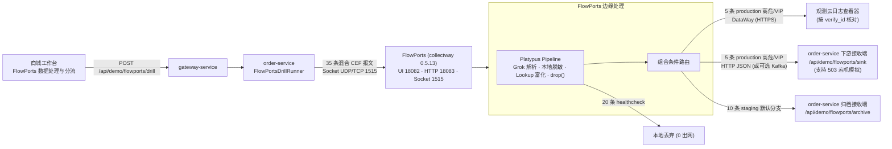

# FlowPorts 数据加工站与多目标分流演练

本文说明如何在不破坏默认部署的前提下，为 `observability-demo` 叠加 **FlowPorts (`collectway 0.5.13`)** 数据加工站（支持 Docker Compose 本地预览、可选 `--profile kafka` 单节点 KRaft Kafka、以及 Kubernetes / EKS 部署），并通过商城工作台右侧「故障注入控制台 → 基础设施 → FlowPorts 数据处理与分流」一键演示 **非标准 CEF 解析、本地合规脱敏、Lookup 富化、入云前降噪、多目标分流与独立队列故障恢复**。

---

## 1. 数据流与对比看点



预置资产位于 [`observability/flowports/`](../observability/flowports/)：

- [`observability/flowports/Dockerfile`](../observability/flowports/Dockerfile)：多架构（`amd64` / `arm64`）官方 `0.5.13` 静态二进制镜像，构建时校验 SHA-256。
- [`observability/flowports/pipelines/mall-gateway.ppl`](../observability/flowports/pipelines/mall-gateway.ppl)：Platypus 脚本，解析带空格 CEF 扩展字段、本地丢弃 `healthcheck`、本地脱敏手机号（明文不出内网）、调用 `mall_vip_catalog` Lookup 富化并写入路由 Tag。
- [`observability/flowports/lookups/mall_vip_catalog.csv`](../observability/flowports/lookups/mall_vip_catalog.csv)：本地 Lookup 字典（`user_id → user_tier / owner_team / cost_center`）。
- [`observability/flowports/fixtures/sample-cef.json`](../observability/flowports/fixtures/sample-cef.json)：供 FlowPorts「样本调试」直接粘贴验证的 3 条典型样本。
- [`observability/flowports/flow-template.json`](../observability/flowports/flow-template.json)：Socket CEF 接入 + 双目标条件分流参考配置。
- [`observability/flowports/mysql-orders-flow-template.json`](../observability/flowports/mysql-orders-flow-template.json)：零代码直连 Demo `selfheal.demo_orders` 表的 `mysql_query` 增量游标参考配置。

---

## 2. Docker Compose 本地叠加步骤

### 2.1 启动轻量版（默认内置下游 HTTP 接收端）

1. 在 `.env` 中补充 FlowPorts 管理员密码（切勿提交真实凭据）：
   ```bash
   FLOWPORTS_ADMIN_PASSWORD="replace-with-your-own-long-password"
   ```
2. 叠加启动（默认管理 UI 映射在 `18082`，避开 Gateway 的 `8080` / `18080`）：
   ```bash
   docker compose -f compose.yaml -f compose.datakit.yaml -f compose.flowports.yaml up -d --build
   ```
3. 检查状态与首次初始化 Token：
   ```bash
   scripts/flowports-setup.sh status
   scripts/flowports-setup.sh setup-token
   ```

### 2.2 可选：启动单节点 KRaft Kafka（复刻 `Socket → FlowPorts → Kafka + DataWay`）

若需 100% 复刻双路投递到 Kafka + 观测云的场景，启动时附加 `--profile kafka`：

```bash
docker compose -f compose.yaml -f compose.datakit.yaml -f compose.flowports.yaml --profile kafka up -d --build
```

Kafka 容器在内部网络暴露 `flowports-kafka:9092`（无 ZooKeeper），可在 FlowPorts「发送目标」添加 Kafka（Topic 如 `mall-flowports-events`、确认方式 `all`、编码 `ndjson`）。

---

## 3. FlowPorts 控制台配置要点

1. **放行内网 CIDR（重要）**：FlowPorts `0.4+` 默认拒绝非公网 HTTP 读取/访问。登录 `http://127.0.0.1:18082` 后，进入 **系统设置 → 网络读取**，按需放行当前 Docker / Kubernetes 容器网段 CIDR，以便向 `http://order-service:8080/api/demo/flowports/sink` 和 `/archive` 投递。
2. **添加发送目标**：
   - **DataWay**：从观测云「集成 → FlowPorts」复制 DataWay 地址（如 `https://openway.guance.com`）与 Workspace Token；
   - **下游业务目标**：添加 HTTP 目标 `http://order-service:8080/api/demo/flowports/sink`（编码 `ndjson`），或启用 `--profile kafka` 后添加 Kafka 目标；
   - **测试归档目标**：添加 HTTP 目标 `http://order-service:8080/api/demo/flowports/archive`。
3. **上传 Lookup 与配置数据流**：
   - 在 Lookup 管理中上传 `observability/flowports/lookups/mall_vip_catalog.csv`，命名为 `mall_vip_catalog`（主键 `user_id`）；
   - 新建数据流，来源选 **Socket**（UDP `0.0.0.0:1515`，解码 `文本行`）；
   - 在 Pipeline 日志源码视图粘贴 `observability/flowports/pipelines/mall-gateway.ppl`，用 `fixtures/sample-cef.json` 执行样本调试；
   - 配置分流规则：`env = production AND risk_level = high` → 勾选 **DataWay** + **下游业务目标**；默认目标勾选 **测试归档目标**；
   - 点击 **保存并发布**，确认 Worker 已安装。

---

## 4. 进阶选配：零代码直连 MySQL `demo_orders` 表

参考 [`observability/flowports/mysql-orders-flow-template.json`](../observability/flowports/mysql-orders-flow-template.json)，可在 FlowPorts 中新建 `mysql_query` 数据流：

- 连接地址：`mysql://mysql:3306/selfheal`（账号 `selfheal`，密码同 `.env` 的 `MYSQL_PASSWORD`）；
- 组合增量游标：`cursor_column = created_at`、`tie_breaker_column = order_id`，确保同一毫秒多笔订单不漏不重；
- 在商城页面正常下单后，无需修改任何业务代码，FlowPorts 每 15 秒增量拉取新订单、通过 `mall_vip_catalog` 富化后同步送往观测云与下游。

---

## 5. Kubernetes / EKS 可选叠加步骤

```bash
kubectl -n datakit create secret generic flowports-credentials \
  --from-literal=COLLECTWAY_ADMIN_PASSWORD="replace-with-your-own-long-password" \
  --dry-run=client -o yaml | kubectl apply -f -

kubectl apply -f observability/flowports/k8s-flowports.example.yaml
kubectl -n datakit rollout status statefulset/flowports --timeout=3m
```

---

## 6. 工作台 4 步现场演练闭环

1. 打开 `business.html?scene=bookstore&view=web`，在右侧 **故障注入控制台 → 基础设施** 选择 **FlowPorts 数据处理与分流**。
2. 点击 **运行 FlowPorts 综合演练（35 条）**（或执行 `scripts/flowports-setup.sh replay-cli`）。
3. 观察面板回显：
   - 漏斗统计展示：`发出 35 条` → `本地预计丢弃 20 条 (57%)` → `下游业务实收 5 / 5`、`测试归档实收 10 / 10`；
   - 底部 JSON 预览可见手机号已脱敏（`138****8000`）且已补充 Lookup 字段；
   - 点击 **打开观测云日志** 按本次 `verify_id:fp-...` 直达观测云日志查看器完成双端核对。
4. **独立持久队列故障韧性演示**：
   - 点击 **模拟下游 503** 开关，再次运行演练；
   - 在 FlowPorts 运行视图可见 **观测云 DataWay 分支照常实时投递**，下游业务分支队列开始积压；
   - 点击 **恢复下游** 后，积压自动清零且下游补齐全部数据，实现零丢数。
